`→ ./shell` [open the interactive terminal](https://jam3s11.github.io/JAM3S11/) and type `help`

`→ cd` [solease](https://github.com/JAM3S11/solease) · [entrywave](https://github.com/JAM3S11/entrywave) · [Quartersortai](https://github.com/JAM3S11/Quartersortai) · [GC-ILCMS](https://github.com/JAM3S11/GC-ILCMS) · [portfolio](https://github.com/JAM3S11/portfolio)

`→ ssh` [LinkedIn](https://linkedin.com/in/james-daniel-jr) · [Medium](https://medium.com/@jdndirangu2020) · [Stack Overflow](https://stackoverflow.com/users/27977762) · [Reddit](https://reddit.com/user/Artistic_Toe5484) · [Pinterest](https://pinterest.com/jdndirangu) · [Email](mailto:YOUR_EMAIL_HERE)
